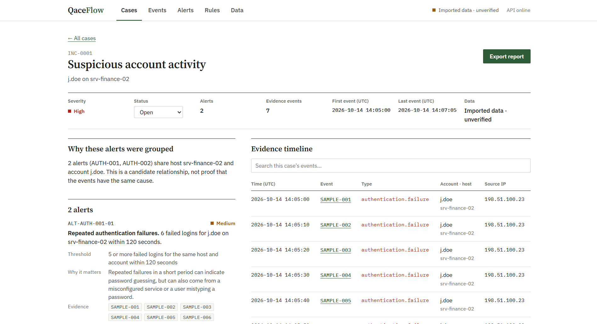
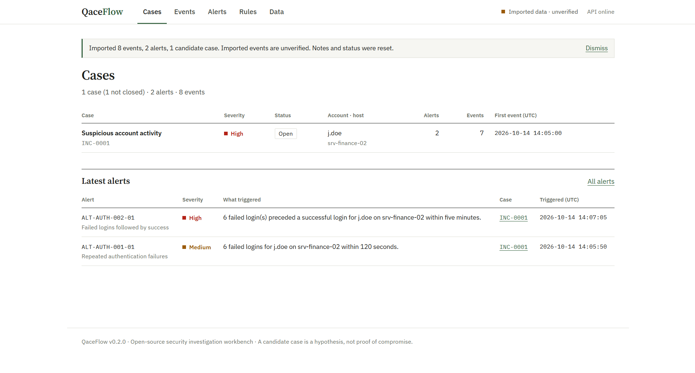
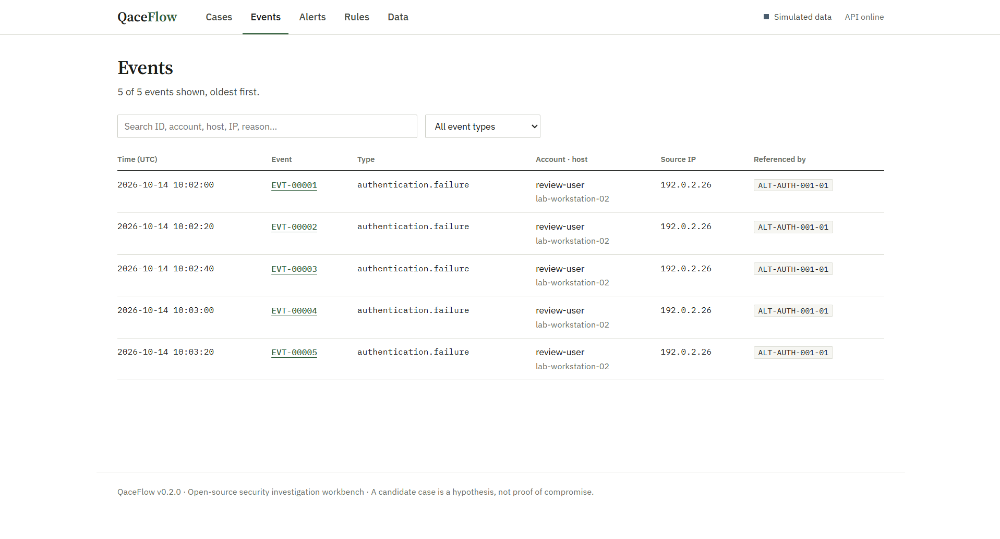
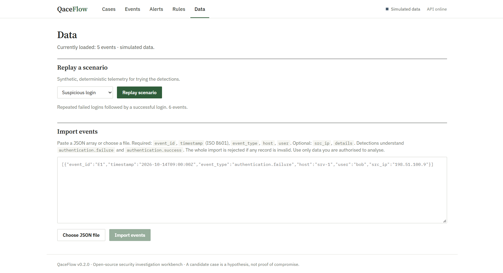

# QaceFlow

[](https://github.com/iaintsurya/QaceFlow/actions/workflows/ci.yml)
[](LICENSE)

**An open-source security investigation workbench for explainable detections and incident correlation.**

QaceFlow is a local-first cybersecurity project designed to explore how security events can be transformed into actionable alerts and candidate incidents. It combines authentication telemetry (synthetic scenarios or your own logs), rule-based detection, basic alert correlation, and a case-oriented investigation interface.

> **Project status:** Early development · v0.3.0  
> **Environment:** Local development, with synthetic scenarios or your own imported logs

## Overview

Security investigations often involve connecting individual events, understanding why detection rules fired, and documenting the evidence behind an incident. QaceFlow explores this workflow through a small, transparent, and reproducible security lab.

The current version offers three deterministic synthetic scenarios and imports of your own JSON or Linux `auth.log` data, evaluates detection rules, correlates related alerts, and presents results as cases, events, alerts and rules in a web interface.

## Screenshots

**Case**: one investigation, with the reason alerts were grouped, each rule's threshold and rationale, and a chronological evidence timeline.



**Cases**: candidate incidents with severity, status and affected account, plus the latest alerts. The header shows that this dataset is imported and unverified.



**Events**: searchable, filterable evidence, showing which alerts reference each event.



**Data**: replay a synthetic scenario or import validated JSON events or a Linux `auth.log`.



A sample exported report is in [`docs/sample-report.md`](docs/sample-report.md), generated from [`docs/sample-events.json`](docs/sample-events.json).

## Documentation

- [Project report](docs/PROJECT_REPORT.md): problem, architecture, detection logic, testing, security and limitations.
- [Learning guide](docs/LEARNING_GUIDE.md): a plain-language tour, worked example, code map, exercises and interview questions.
- [Changelog](CHANGELOG.md)

## Features

- **Scenario library:** Replay suspicious-login, repeated-failures and benign-login synthetic activity.
- **Rule-based detection:** Identify repeated authentication failures and failures followed by success.
- **Alert correlation:** Group related alerts sharing the same host and account into a candidate incident.
- **Event explorer:** Search event IDs, timestamps, users, hosts, source IPs, event types and reasons.
- **Evidence references:** Connect alerts and candidate incidents to the event IDs that support them.
- **Investigation workspace:** Inspect the incident rationale, related alerts, chronological evidence and raw event payloads.
- **Persistent analyst notes:** Save investigation notes to SQLite and reload them later.
- **Incident lifecycle:** Change incident status between open, investigating and closed.
- **Report export:** Download a Markdown report containing incident metadata, analyst notes, related alerts and evidence references.
- **Real log import:** Analyse a Linux OpenSSH `auth.log` (failed and accepted logins), with the original log line kept as evidence.
- **MITRE ATT&CK mapping:** Each rule references the adversary technique it is designed to surface (indicative, not a verdict).
- **Local-first development:** Run the frontend and API on your own machine using synthetic scenarios or your own logs.

## Interface

The interface is organised around the investigation workflow rather than a dashboard:

| Page | Purpose |
|---|---|
| **Cases** | Candidate incidents with severity, status, affected account and host, and the latest alerts |
| **Case** | One investigation: why alerts were grouped, each alert's rule threshold and rationale, evidence timeline with raw events, status, analyst findings (Ctrl+S saves) and report export |
| **Events** | Searchable, filterable event table; open an event for its raw payload and see which alerts reference it |
| **Alerts** | Every alert with its rule, severity, evidence count and owning case; expand for the explanation |
| **Rules** | The detection rules, their exact thresholds, and what innocent activity could trigger them |
| **Data** | Replay a synthetic scenario or import your own JSON events |

The header always shows whether the loaded events are simulated or imported (unverified). Routes use the URL hash (`#/cases/INC-0001`), so pages can be bookmarked and the back button works.

## Architecture

```text
Synthetic authentication scenario
              |
              v
       Event generation
              |
              v
       Detection engine
              |
              v
         Alert records
              |
              v
      Correlation engine
              |
              v
      Candidate incident
              |
              v
       React interface
              |
              v
       Analyst review
              |
              v
   Persistent notes + report export
```

### Technology stack

| Component | Technology |
|---|---|
| Frontend | React, TypeScript, Vite |
| Backend | Python, FastAPI |
| Data storage | SQLite |
| API documentation | OpenAPI / Swagger UI |
| Version control | Git and GitHub |

## Detection rules

| Rule ID | Detection | Purpose | ATT&CK (indicative) |
|---|---|---|---|
| `AUTH-001` | Repeated authentication failures | Detect five or more failures for the same host and account within a 120-second window. | T1110 Brute Force |
| `AUTH-002` | Failures followed by success | Identify a successful login preceded by failures for the same host and account within five minutes. | T1110 Brute Force, T1078 Valid Accounts |

These rules are intentionally simple and explainable. A rule match is an investigative signal, not proof of malicious activity.

## Getting started

### Prerequisites

- Python 3.11 or newer
- Node.js 20 or newer
- npm
- Git

### 1. Clone the repository

```bash
git clone https://github.com/iaintsurya/QaceFlow.git
cd QaceFlow
```

### 2. Set up the backend

```powershell
cd backend
py -m venv .venv
.\.venv\Scripts\Activate.ps1
python -m pip install -r requirements.txt
python -m uvicorn app.main:app --reload
```

If the `python` command is unavailable, use `.\.venv\Scripts\python.exe` in its place.

The API runs at `http://127.0.0.1:8000`.

To run the tests, install the development requirements and run pytest from the `backend` folder:

```powershell
python -m pip install -r requirements-dev.txt
python -m pytest
```

Interactive API documentation: `http://127.0.0.1:8000/docs`

### 3. Set up the frontend

Open a second terminal at the repository root and run:

```powershell
cd frontend
npm install
npm run dev
```

Open the local URL printed by Vite, usually `http://localhost:5173`.

### 4. Run the demo

1. Make sure the backend and the frontend are both running, then open QaceFlow in your browser.
2. Open the **Data** page, keep **Suspicious login** selected and choose **Replay scenario**.
3. You land on **Cases** with one candidate case. Open it to see why its alerts were grouped, each rule's threshold and rationale, and the evidence timeline.
4. Record your findings, set a status and choose **Export report**.

Replaying a scenario resets the local dataset, including saved notes and status.

## Demo scenarios

| Scenario | Expected result |
| --- | --- |
| `suspicious-login` | 6 events, 2 alerts, 1 candidate incident |
| `repeated-failures` | 5 events, 1 alert, 0 incidents |
| `benign-login` | 3 events, 0 alerts, 0 incidents |

All scenario data is synthetic. Replaying any scenario replaces the active demo dataset and clears notes attached to the previous demo incident. Export or copy any findings you need before replaying.

The scenario catalog is available at `GET /api/scenarios`. Replay one with `POST /api/scenarios/{scenario_id}/replay`. The original `POST /api/scenarios/suspicious-login/replay` route remains supported.

## Importing events

Use the **Import events** panel in the UI, or call the API directly with a JSON body of the form `{"events": [...]}`. A ready-made example is in [`docs/sample-events.json`](docs/sample-events.json).

| Field | Required | Notes |
|---|---|---|
| `event_id` | yes | Unique within the file |
| `timestamp` | yes | ISO 8601; converted to UTC |
| `event_type` | yes | Detections understand `authentication.failure` and `authentication.success`; other types are stored but not evaluated |
| `host`, `user` | yes | Used for detection and correlation |
| `src_ip` | no | Must be a valid IPv4 or IPv6 address |
| `details` | no | Free-form object |

Imports are all-or-nothing: if any record is invalid, nothing is stored and up to 25 problems are returned. Imported events are labelled `imported` and reports describe them as unverified. Up to 5,000 events can be imported at once. Importing replaces the active dataset and clears notes, like scenario replay.

### Linux auth.log

Choose **Linux auth.log (OpenSSH)** as the format on the Data page, or send `{"format": "sshd-auth-log", "text": "<file contents>", "year": 2026}` to the same endpoint. A ready-made example is in [`docs/sample-auth.log`](docs/sample-auth.log): a burst of failed logins against `root` followed by a successful one, mixed with ordinary log noise.

- Only `Failed <method> for ...` and `Accepted <method> for ...` lines from `sshd` become events; everything else is skipped and the number of skipped lines is reported.
- Syslog lines carry no year or time zone, so you supply the year and times are treated as UTC.
- The original log line is stored in the event details and shown as evidence.
- Files up to 5 MB and 5,000 login events are accepted. Use only logs you are authorised to analyse.

## API endpoints

| Method | Endpoint | Purpose |
|---|---|---|
| GET | `/api/health` | Check API health |
| GET | `/api/events` | List generated events |
| GET | `/api/alerts` | List detection alerts |
| GET | `/api/incidents` | List candidate incidents |
| GET | `/api/rules` | List detection rules with thresholds and explanations |
| GET | `/api/scenarios` | List the synthetic demo scenarios |
| POST | `/api/events/import` | Validate and import events as `{"events": [...]}` or an OpenSSH log as `{"format": "sshd-auth-log", "text": "...", "year": 2026}` (all-or-nothing; replaces the active dataset) |
| POST | `/api/scenarios/{scenario_id}/replay` | Replay a scenario (resets events, alerts, incidents and notes) |
| GET / PUT | `/api/incidents/{id}/notes` | Read or save analyst notes (max 20,000 characters) |
| PUT | `/api/incidents/{id}/status` | Set status to `open`, `investigating` or `closed` |
| GET | `/api/incidents/{id}/report` | Authoritative JSON snapshot of the saved investigation |
| GET | `/api/incidents/{id}/report.md` | Download the investigation report as Markdown |

Alert IDs are unique and stable, in the form `ALT-<rule>-<nn>` (for example `ALT-AUTH-001-01`).

## Testing and continuous integration

GitHub Actions runs the backend tests and the frontend production build on every push and pull request (`.github/workflows/ci.yml`). Locally: `pip install -r backend/requirements-dev.txt && python -m pytest` in `backend`, and `npm run build` in `frontend`.

## Project roadmap

- [x] Add automated tests for detection and correlation logic.
- [x] Build a dedicated incident investigation page.
- [x] Add persistent analyst notes and investigation findings.
- [x] Improve evidence timelines and event inspection.
- [x] Add investigation report export (Markdown).
- [x] Support validated imports of authorized, sanitized telemetry (JSON and Linux auth.log).
- [ ] Password-spraying rule and correlation by source IP.
- [ ] Frontend unit tests.
- [ ] Add versioned detection-rule definitions.
- [ ] Improve API security and deployment readiness.

## Security and limitations

QaceFlow is an educational development project, not a production SIEM or incident-response platform.

- The built-in scenarios use synthetic telemetry. Imported data is labelled unverified throughout the interface and in reports.
- Detection and correlation logic is intentionally basic.
- The development API does not include authentication.
- The replay endpoint resets the local demo dataset, including saved notes and incident status.
- `AUTH-002` fires after a single failure followed by a success, so it can flag a simple typo; the threshold lives in `RULES` in `engine.py`.
- Correlation groups alerts only by shared host and account.
- The application should remain on localhost and must not be exposed publicly in its current state.

Only import logs you are authorised to analyse, and prefer sanitized samples. There is no authentication and data is stored unencrypted in a local SQLite file. To report a vulnerability in QaceFlow itself, see [`SECURITY.md`](SECURITY.md).

## Contributing

Contributions, bug reports, and suggestions are welcome. Please open an issue to discuss significant changes before submitting a pull request. Setup, test and commit conventions are in [`CONTRIBUTING.md`](CONTRIBUTING.md).

## License

Released under the [MIT License](LICENSE).

---

**QaceFlow** — From security signals to evidence-backed investigations.
