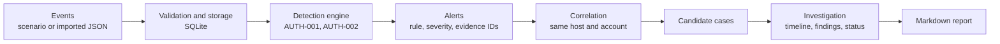

# QaceFlow: Project Report

**Version 0.2.0 · Open-source security investigation workbench**
Repository: https://github.com/iaintsurya/QaceFlow

## 1. Summary

QaceFlow is a local-first web application that helps a security analyst move from raw authentication events to an investigated, documented incident. It stores events, runs deterministic detection rules, explains every alert, groups related alerts into a *candidate* case, lets the analyst record findings, and exports a report.

The project deliberately favours **explainability over automation**: every alert states its rule, its exact threshold and the events that triggered it, and the interface never presents a correlated case as proof of compromise.

## 2. Problem and motivation

A single computer produces large volumes of security logs. Somewhere in them, an attacker may repeatedly guess a password and then succeed. Analysts must answer, quickly and defensibly:

- What happened, and which events look suspicious?
- Why did the system raise an alert?
- Which alerts are related?
- What evidence supports the conclusion, and what did the analyst decide?

Many tools hide the reasoning behind opaque scores. QaceFlow shows its working, which makes it useful for learning security operations and for testing detection ideas.

## 3. Goals and non-goals

**Goals**
- A complete, working investigation workflow: events → detections → alerts → correlation → investigation → report.
- Deterministic, testable, explainable detection logic.
- Investigation data that persists across reloads and restarts.
- A professional, evidence-first interface usable by beginners.

**Non-goals (deliberately out of scope for v0.2)**
- Live log collection, agents, or integrations with external SIEMs.
- Authentication, multi-user roles, or hosted deployment.
- AI-generated conclusions. A deterministic baseline must come first.

## 4. Intended users

- Cybersecurity students learning security operations and incident response.
- Junior SOC analysts investigating authentication alerts.
- Developers and researchers experimenting with explainable detection and correlation.

## 5. System overview

Every page and endpoint supports this workflow.

## 6. Architecture

| Layer | Technology | Responsibility |
|---|---|---|
| Frontend | React, TypeScript, Vite | Cases, events, alerts, rules, data and case pages; no business logic |
| API | Python, FastAPI | Request validation, predictable JSON, HTTP status codes |
| Detection | Pure Python (`engine.py`) | Rule evaluation and correlation; no I/O, so fully unit-testable |
| Ingestion | Pure Python (`ingest.py`) | Validation and normalisation of imported events |
| Reporting | Pure Python (`reporting.py`) | Builds the Markdown report from a stored snapshot |
| Persistence | SQLite | Events, alerts, cases, analyst notes |
| CI | GitHub Actions | Backend tests and frontend production build on every push |

Design principle: **the server is the source of truth.** The report is generated from what the database holds, not from data the browser sends, so a report always reflects the saved investigation.

### Backend modules

| File | Role |
|---|---|
| `app/main.py` | FastAPI routes, SQLite access, request validation |
| `app/engine.py` | Rule catalogue, `detect()`, `correlate()` |
| `app/scenarios.py` | Three deterministic synthetic scenarios |
| `app/ingest.py` | All-or-nothing validation of imported events |
| `app/reporting.py` | Markdown report generator |

### Frontend modules

| File | Role |
|---|---|
| `src/api.ts` | Typed API client with structured error handling |
| `src/router.ts` | Hash router (`#/cases/INC-0001`) |
| `src/pages/*` | Cases, Case, Events, Alerts, Rules, Data |
| `src/components/*` | Top bar and shared UI primitives |
| `src/app.css` | Single design system (tokens, tables, forms) |

## 7. Data model

| Table | Key columns |
|---|---|
| `events` | `event_id` (PK), `timestamp` (UTC), `event_type`, `host`, `user`, `source`, `src_ip`, `payload` (raw JSON) |
| `alerts` | `id` (PK), `rule_id`, `severity`, `summary`, `matched_event_ids`, `entity`, `created_at` |
| `incidents` | `id` (PK), `title`, `status`, `severity`, `alert_ids`, `event_ids`, `entities`, `correlation_reason` |
| `incident_notes` | `incident_id` (PK), `notes`, `updated_at` |

Timestamps are stored in UTC. The `source` column records provenance: `simulated_auth_log` for scenarios and `imported` for analyst-supplied data.

## 8. Detection engine

Rules are defined in one catalogue (`RULES`) so the engine, the API and the report all describe a rule identically.

| Rule | Severity | Triggers when | Why it matters (and what could be innocent) |
|---|---|---|---|
| **AUTH-001** Repeated authentication failures | Medium | 5 or more failed logins for the same host and account within 120 seconds | Possible password guessing; could be a misconfigured service or a mistyped password |
| **AUTH-002** Failed logins followed by success | High | A successful login preceded by at least 1 failed login for the same host and account within 5 minutes | A guessed or reused credential may have been accepted; could be a corrected typo |

**Properties**
- *Deterministic:* the same events always produce the same alerts, regardless of input order (events are sorted before evaluation).
- *Burst-aware:* `AUTH-001` uses a sliding window and finds every separate burst, not only the first.
- *Unique, stable alert IDs:* `ALT-<rule>-<nn>`, for example `ALT-AUTH-001-01`.
- *Explainable:* each alert carries its threshold, rationale and matched event IDs.

## 9. Correlation

Alerts that share the same **host and account** are grouped. Two or more alerts form a candidate case. Severity is *high* if any grouped alert is high. The case stores a plain-language reason, for example: "2 alerts (AUTH-001, AUTH-002) share host lab-workstation-01 and account demo-user. This is a candidate relationship, not proof that the events have the same cause."

## 10. Ingestion and validation

Analysts can import their own events as JSON. Validation checks required fields (`event_id`, `timestamp`, `event_type`, `host`, `user`), ISO 8601 timestamps (converted to UTC), IP address format, duplicate event IDs, field lengths, and a 5,000-event limit. The import is **all-or-nothing**: one invalid record rejects the file and nothing is stored, and up to 25 problems are returned with record numbers. Imported events are labelled `imported`, and the interface and reports describe them as unverified.

## 11. Investigation and reporting

On a case page the analyst sees why the alerts were grouped, each alert's threshold and rationale, a chronological evidence timeline with raw event inspection, and a findings editor. Status moves between `open`, `investigating` and `closed`. Findings are limited to 20,000 characters and saved to SQLite. Ctrl+S saves, and leaving with unsaved findings asks for confirmation.

The exported Markdown report contains case metadata, the correlation reason, alerts with thresholds and evidence references, the timeline, the analyst findings and known limitations. A sample is in [`sample-report.md`](sample-report.md).

## 12. API

| Method | Path | Purpose |
|---|---|---|
| GET | `/api/health` | Service health |
| GET | `/api/events`, `/api/alerts`, `/api/incidents` | Lists |
| GET | `/api/rules` | Rules with thresholds and rationale |
| GET | `/api/scenarios` | Synthetic scenarios |
| POST | `/api/scenarios/{id}/replay` | Load a scenario (replaces the dataset) |
| POST | `/api/events/import` | Validate and import events (replaces the dataset) |
| GET / PUT | `/api/incidents/{id}/notes` | Read or save findings |
| PUT | `/api/incidents/{id}/status` | Set status |
| GET | `/api/incidents/{id}/report` | JSON snapshot of the saved investigation |
| GET | `/api/incidents/{id}/report.md` | Markdown report download |

Errors are structured and use sensible status codes: 404 for unknown cases, 413 for oversized notes, 422 for rejected imports.

## 13. Interface design

The interface is organised around the investigation, not a dashboard. It uses a slim top bar with text tabs, dense tables and hairline rules instead of cards and tiles. Headings are set in a serif for an editorial, case-file feel; IDs, timestamps and IP addresses are monospaced. The palette is white and ink with one green accent for primary actions, and red or amber only where they carry severity meaning. The header always states whether the loaded events are simulated or imported.

Accessibility measures: visible keyboard focus, semantic tables, labelled controls, `aria-expanded` on expandable rows, and responsive layouts.

## 14. Testing and quality

63 automated tests run on every push in GitHub Actions, alongside the frontend production build.

| Suite | Tests | Covers |
|---|---|---|
| `test_engine.py` | 24 | Window boundaries (exactly 120 s and 121 s, exactly 5 minutes), repeated bursts, unique IDs, input-order independence, different hosts, correlation |
| `test_api.py` | 19 | Replay, notes, status, reports, restart persistence, import, rejected imports, 404 and 413 paths |
| `test_ingest.py` | 8 | Required fields, timestamps, IPs, duplicates, limits, UTC conversion |
| `test_reporting.py` | 7 | Metadata, ordering, escaping, empty states, imported-data labelling |
| `test_scenarios.py` | 5 | Determinism and expected scenario outcomes |

## 15. Security and privacy

- **Local-first:** no external services, no telemetry, no credentials stored.
- **Input validation:** imports and notes are validated; sizes are capped.
- **Output safety:** the frontend renders data through React, which escapes content; report cells escape Markdown table characters.
- **Restricted CORS:** only the local development origins and the GET, POST and PUT methods are allowed.
- **Honest labelling:** simulated and imported data are never presented as confirmed attacks.

## 16. Engineering process

The project was built in small, tested batches with meaningful commits. Verification came before claims: bugs found by review and testing included alert ID collisions (two matches of one rule would have crashed replay), only the first failure burst being detected, a hard-coded case ID in the interface, navigation links that did nothing, and data labelled "simulated" after an import. Each was fixed with a test or a visible change. The interface was redesigned after review of real screenshots.

## 17. Known limitations

- Detection covers authentication events only, with two threshold rules.
- `AUTH-002` fires after a single failure followed by a success, so it can flag a simple typo.
- Correlation groups only by shared host and account.
- No authentication or multi-user support; intended for local use.
- Replaying a scenario or importing events replaces the dataset and clears notes and status (the interface asks for confirmation).
- The Markdown report is the only export format.

## 18. Future work

1. Evidence relationship graph linking events, accounts, hosts, IPs, alerts and cases.
2. Additional rules (new source IP, impossible travel, off-hours logins) with false-positive tests.
3. CSV import and richer event filters.
4. Per-case checklists and annotated evidence.
5. PDF report export.
6. Optional authentication for shared deployments.

## 19. Skills demonstrated

Full-stack development (React, TypeScript, FastAPI, SQLite); detection engineering and explainable alerting; API design and validation; automated testing and continuous integration; secure-by-default input handling; interface and information design; and disciplined Git workflow.
